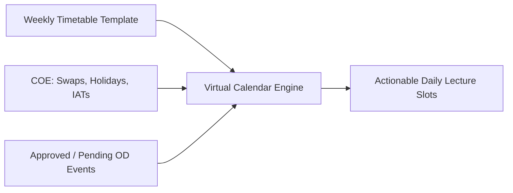
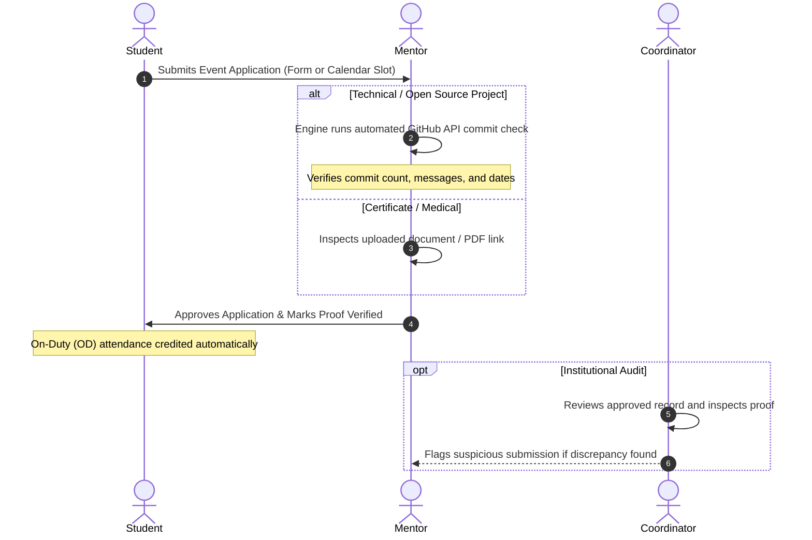

# Comprehensive Features Guide
## The Attendance & Extracurricular Manager (CampusFlow)

> **Moto**: *Empower students to excel in academics and extracurriculars with ease, transparency, and confidence.*

---

## Table of Contents
1. [Core Philosophy & Problem Solved](#1-core-philosophy--problem-solved)
2. [Dual Attendance Tracking Engine](#2-dual-attendance-tracking-engine)
3. [Mid-Semester Baseline Ingestion](#3-mid-semester-baseline-ingestion)
4. [Virtual Calendar & Schedule Engine](#4-virtual-calendar--schedule-engine)
5. [Event Filing & Automated Proof Verification](#5-event-filing--automated-proof-verification)
6. [Role-Specific Portals & Workflows](#6-role-specific-portals--workflows)
   - [6.1 Student Dashboard](#61-student-dashboard)
   - [6.2 Mentor Portal](#62-mentor-portal)
   - [6.3 Lecturer Transparency Board](#63-lecturer-transparency-board)
   - [6.4 Coordinator Audit Console](#64-coordinator-audit-console)
7. [Mobile & Progressive Web App (PWA) Support](#7-mobile--progressive-web-app-pwa-support)
8. [End-to-End User Scenarios](#8-end-to-end-user-scenarios)

---

## 1. Core Philosophy & Problem Solved

College students who participate actively in hackathons, open-source projects, competitive programming, sports tournaments, and internships face two persistent barriers:
1. **Attendance Panic & Cut-off Anxiety**: Strict attendance rules (e.g. 75% or 85%) threaten students with exam detention or hall-ticket cancellation if they miss classes for competitions.
2. **Faculty Prejudice**: Lecturers seeing an empty seat often assume the student is irresponsible or bunking carelessly. Without context, students receive negative bias in internal assessments and project grading.

CampusFlow solves both problems through **institutional transparency**:
- It tracks **two distinct attendance metrics**: Physical classroom presence and Standard On-Duty (OD) attendance.
- It provides mentors with tools to **verify proof automatically** (such as GitHub commits for software projects).
- It provides lecturers with a **non-punitive transparency board** showing which students are attending verified hackathons or project sprints, turning prejudice into encouragement.

---

## 2. Dual Attendance Tracking Engine

CampusFlow replaces simple attendance percentages with a dual calculation model.

```
┌────────────────────────────────────────────────────────────────────────┐
│                        DUAL ATTENDANCE MODEL                           │
├──────────────────────────────────┬─────────────────────────────────────┤
│ 1. Raw In-Person Attendance %    │ 2. Standard On-Duty (OD) %          │
│                                  │                                     │
│     Classes Physically Attended  │     Attended + Approved OD Classes  │
│     ───────────────────────────  │     ──────────────────────────────  │
│       Total Classes Conducted    │        Total Classes Conducted      │
│                                  │                                     │
│  • Represents actual classroom   │  • Official institutional credit    │
│    seat time.                    │  • Determines exam eligibility      │
│  • Valued independently by       │  • Accounts for sanctioned fests,   │
│    subject professors.           │    sports, and medical leaves       │
└──────────────────────────────────┴─────────────────────────────────────┘
```

### 2.1 Flexible Tier System
Rather than a single hard cut-off, CampusFlow supports a tiered compliance policy:

| Tier Name | Range | Policy Meaning & Concession |
| :--- | :--- | :--- |
| **Safe Tier** | $\ge 85\%$ | Standard clean attendance; full exam eligibility without requiring exemptions. |
| **Medical Concession Tier** | $75.0\% - 84.9\%$ | Permitted for students who submit valid medical documentation or clinical slips. |
| **Extracurricular / Internship Tier** | Flexible down to $\ge 40\%$ | Sanctioned for students representing the college at national hackathons, university sports, or pursuing approved industry internships. |
| **Critical Risk Tier** | $< 40\%$ | Severe detention risk; triggers alerts to student, mentor, and department heads. |

### 2.2 Mathematical Formulas & Calculations

#### Safe-to-Miss Calculator (Safe Bunks)
Students can see exactly how many upcoming classes of a subject they can miss before their attendance drops below a target percentage ($T = 85\%$ or $75\%$):

$$\text{Safe Bunks} = \max\left(0, \left\lfloor \frac{\text{Total With OD} - \left(\frac{T}{100} \times \text{Conducted}\right)}{\frac{T}{100}} \right\rfloor\right)$$

*Example*: If a student has attended 18 out of 20 classes ($90\%$), for $T = 85\%$:
$$\left\lfloor \frac{18 - (0.85 \times 20)}{0.85} \right\rfloor = \left\lfloor \frac{18 - 17}{0.85} \right\rfloor = 1 \text{ class can be safely missed.}$$

#### Recovery Calculator
If a student's attendance drops below target $T$, the system computes how many consecutive classes they must attend without missing to recover:

$$\text{Classes Needed} = \left\lceil \frac{\left(\frac{T}{100} \times \text{Conducted}\right) - \text{Total With OD}}{1 - \frac{T}{100}} \right\rceil$$

### 2.3 Safe-to-Miss Simulator
Before committing to an event, students use the built-in simulator:
1. Select the subject they would miss.
2. Enter the number of sessions they plan to miss (e.g., 2 lectures).
3. Toggle whether the absence will be covered by approved On-Duty leave.
4. **Live Projection**: The engine displays projected Physical % and projected OD %, and fires an alert if a **High Importance** subject drops below the safe zone.

---

## 3. Mid-Semester Baseline Ingestion

### The Problem
When deploying an attendance manager mid-semester, students cannot manually input 30–60 individual past lecture dates.

### The Solution: Baseline Snapshot
CampusFlow allows students to enter a **baseline snapshot** per subject directly from their college portal (ERP, Contineo, SAP, or spreadsheet):
- **`baselineConducted`**: Number of classes conducted up to the snapshot date.
- **`baselineAttended`**: Number of classes physically attended up to the snapshot date.

### How It Works Moving Forward
Once the baseline snapshot is saved:
$$\text{Current Total Conducted} = \text{Baseline Conducted} + \text{Ongoing Tracked Classes}$$
$$\text{Current Total Attended} = \text{Baseline Attended} + \text{Ongoing Tracked Classes Attended}$$
$$\text{Current Total OD} = \text{Ongoing Tracked Classes Marked On-Duty}$$

Students can adjust their baseline snapshot at any time via the **Baseline Ingestion Modal**.

---

## 4. Virtual Calendar & Schedule Engine

The calendar brings together three dynamic sources to produce a daily actionable schedule:



### 4.1 Calendar of Events (COE) Resolution
College calendars contain non-standard days indicated by highlights:
- **Timetable Swaps (Yellow Highlight)**: For example, a Wednesday that follows Monday's timetable because a prior Monday was a public holiday. The engine overrides Wednesday's slots and automatically serves Monday's class schedule.
- **Internal Assessment Tests / IATs (Grey Highlight)**: Internal exams replace normal lecture periods. The engine recognizes IAT days as special exam days and suppresses regular lecture attendance expectations.
- **Holidays (Yellow Highlight)**: Official campus holidays where no lecture records or penalties are applied.

### 4.2 Interactive Slot Statuses
Each period on the daily schedule displays an explicit status:
- 🟢 **Attended**: Classroom presence confirmed.
- 🔵 **On-Duty (OD)**: Student is attending an approved hackathon, project sprint, tournament, or medical leave. Displays event title and category.
- 🔴 **Unexcused Absence**: Absent without an approved OD application.
- ⚪ **Scheduled**: Upcoming class slot.

Students can click on any slot directly to open the **File Event Modal** pre-filled with that date and time.

---

## 5. Event Filing & Automated Proof Verification



### 5.1 Flexible Filing Policy
- **Filing with Proof**: Upload certificate URL, doctor's prescription, or GitHub repository URL.
- **Filing without Proof**: Permitted initially so students can notify mentors in advance. However, the system enforces: **"Mentor cannot approve without valid proof."**

### 5.2 Automated GitHub Commit Verifier
For open-source contributions and development hackathons, manual verification is tedious. CampusFlow provides automated GitHub verification:
1. Student provides:
   - **Repository URL** (e.g., `https://github.com/facebook/rocksdb`)
   - **GitHub Username** (e.g., `aarav-code`)
   - Event date window (`startDate` to `endDate`)
2. The verification engine queries the public GitHub REST API:
   ```http
   GET https://api.github.com/repos/{owner}/{repo}/commits?since={start}&until={end}&author={username}
   ```
3. The engine parses the response:
   - Checks if commits exist within the event window.
   - Compiles commit count and sample commit messages.
   - Displays a verified summary card directly inside the mentor's review queue:
     > *"Successfully verified 9 commit(s) by aarav-code between Oct 10 and Oct 14: 'feat: add Raft consensus leader election', 'test: add storage benchmarks'..."*

### 5.3 Supported Event Categories
- 🏆 **Hackathons**: College fests, national hackathons (Smart India Hackathon, MLH, etc.).
- 💻 **Development / Projects**: Open-source sprints, research lab prototypes.
- ⚽ **Sports Tournaments**: University, zonal, or state athletic championships.
- 🏥 **Medical Leave**: Hospitalization, clinical recovery (with medical slip).
- 💼 **Internships**: Approved full-time/part-time industry internships (flexible down to 40% tier).
- 📝 **External / Makeup Exams**: Competitive exams (GATE, GRE), university supplementary tests.
- 🎓 **Webinars & Conferences**: IEEE, ACM, or industry technical seminars.

---

## 6. Role-Specific Portals & Workflows

### 6.1 Student Dashboard
- **Dual Meter Cards**: Prominent side-by-side display of On-Duty % and Physical In-Person %.
- **Subject Cards**: High/Medium/Low importance tags, individual subject dual-bars, and safe-to-miss chips.
- **Interactive Calendar**: Day navigation with quick picks for COE events (Oct 21 Timetable Swap, Oct 23 IAT Exam).
- **Safe-to-Miss Simulator**: Interactive slider to test attendance drops before applying.
- **Extracurricular Discovery Hub**: Filterable feed of upcoming hackathons and tournaments with an "Apply for OD" button.
- **My Applications Tab**: Real-time status tracker for submitted requests (`APPROVED`, `PENDING_APPROVAL`, `FLAGGED_BY_COORDINATOR`, `REJECTED`).

### 6.2 Mentor Portal
- **Primary Approver**: Mentors hold direct decision authority over event requests and proof validity.
- **Pending Review Queue**: Displays student's current dual attendance, event dates, description, and attached proof.
- **GitHub Commit Inspector**: View one-click verified commit stats without leaving the dashboard.
- **Approve Action**: Automatically updates application status to `APPROVED` and generates `ON_DUTY` class records for all overlapping lecture slots.
- **Mentee Attendance Health Board**: Table of all assigned mentees showing who is safe ($>85\%$), in medical concession ($>75\%$), in internship concession ($>40\%$), or at risk ($<40\%$).

### 6.3 Lecturer Transparency Board
- **Purpose**: Prevent professor prejudice against active students who miss lectures for legitimate extracurricular reasons.
- **Transparency Roster**:
  - 🔵 **Approved On-Duty**: Displays student's verified project or competition name, category, and approving mentor.
  - 🟢 **Present**: Student was physically present in class.
  - 🔴 **Unexcused Absence**: Student was absent without a verified OD record.
- **Faculty Action**: Includes a direct "Contact Mentor" button so the professor can coordinate supportively with the student's mentor rather than penalizing the student.

### 6.4 Coordinator Audit Console
- **Institutional Compliance**: Access to all approved On-Duty records across departments.
- **Deep Inspection**: Review proof URLs and GitHub repository links.
- **Flagging Mechanism**: If a coordinator suspects mismatched dates or invalid documentation, they can flag the application and attach an audit note for mentor review.

---

## 7. Mobile & Progressive Web App (PWA) Support

CampusFlow is designed mobile-first to ensure a seamless experience on smartphones and tablets:
- **Responsive Layout**: Fluid grids and collapsible navigation tailored for touchscreens.
- **Web App Manifest (`public/manifest.json`)**: Configured with `display: standalone` for home-screen installation on Android and iOS without app store distribution.
- **Touch-Optimized Viewport**: Disables accidental double-tap zoom and respects native device safe areas (`viewport-fit=cover`).

---

## 8. End-to-End User Scenarios

### Scenario A: Aarav applies for Smart India Hackathon
1. **Aarav (Student)** views his calendar for Oct 15–16. He clicks "+ File Event / OD".
2. He selects category **Hackathon**, inputs dates, and attaches his registration ticket link.
3. **Dr. Rajesh Rao (Mentor)** switches to his Mentor Portal. He sees Aarav's pending request, reviews the ticket link, and clicks **"Approve & Credit OD"**.
4. Aarav's calendar immediately updates: his Oct 15–16 lectures are marked **On-Duty (Hackathon)**.
5. His OD attendance stays strong at **85.7%** (above the 85% safe tier), while his physical presence remains accurately tracked.
6. **Prof. Vikram Singh (Lecturer)** opens his class roster on Oct 16. Instead of an unexcused absence, he sees: *On-Duty: Smart India Hackathon (Mentor Verified by Dr. Rao)*. Prof. Singh knows Aarav is representing the college and encourages him.

### Scenario B: Aarav files an Open-Source Development Sprint
1. Aarav spends Oct 10–14 contributing to a key-value storage engine.
2. He files an event with category **Development / Project**, selects **GitHub Commits (Auto-Verified)**, and provides `https://github.com/facebook/rocksdb` with username `aarav-code`.
3. The engine automatically inspects GitHub commits and verifies 9 commits in the date window.
4. When Dr. Rao opens his review queue, he sees the verified commit summary and sample messages, allowing him to approve with full confidence.

### Scenario C: Sneha on a Full-Time Industry Internship
1. Sneha Reddy is doing a full-time internship under the college MoU. Her raw in-person attendance is 53.5%.
2. Under traditional rules, she would be detained ($< 75\%$).
3. CampusFlow evaluates her against the **Internship / Extracurricular Flexible Tier ($\ge 40\%$)**.
4. Her dashboard marks her status as **Compliant within the Extracurricular / Internship Concession Range**, protecting her hall ticket and academic eligibility.
