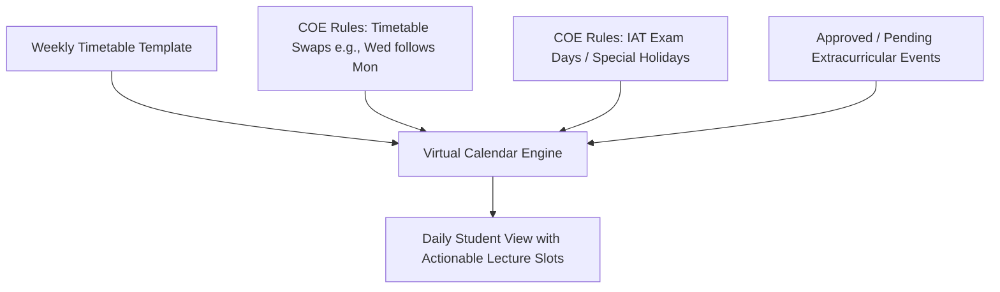
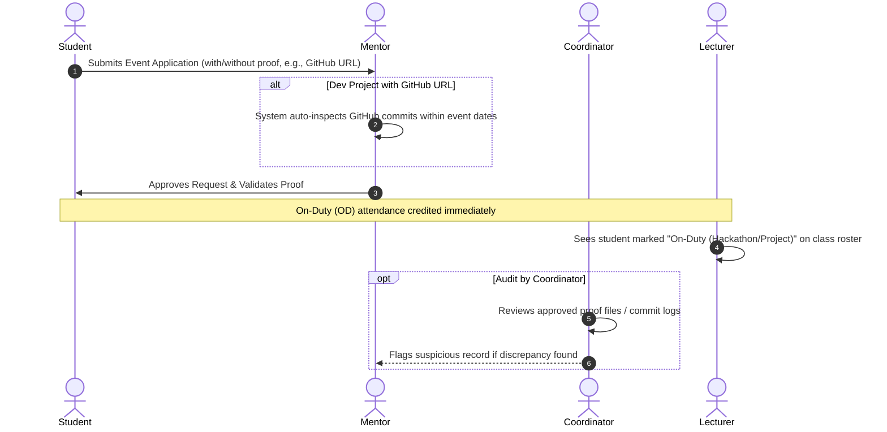

# The Attendance & Extracurricular Manager
> **Moto**: *Empower students to excel in academics and extracurriculars with ease, transparency, and confidence.*

---

## 1. Project Overview & Philosophy

In modern college environments, proactive students frequently participate in hackathons, sports tournaments, research, internships, and open-source projects. However, they face two constant friction points:
1. **Attendance Risk & Rigidity**: Fear of dipping below strict attendance cut-offs (e.g., 75% or 85%) and losing hall tickets or exam eligibility.
2. **Lecturer Prejudice**: Professors often assume absent students are irresponsibly skipping classes when they are actually working on legitimate extracurricular or technical achievements.

This project delivers an intelligent **Dual Attendance & Virtual Calendar Platform** that:
- Accurately tracks **Physical Attendance vs. On-Duty (OD) Attendance**.
- Accommodates ongoing semesters with **mid-semester baseline data import**.
- Supports flexible cut-offs down to **40% for internships and major extracurriculars**.
- Automates **proof verification** (including GitHub commit checks for dev projects).
- Gives mentors direct approval authority and provides lecturers with a **non-punitive transparency view** to foster understanding rather than bias.
- Offers a responsive, mobile-first design (PWA) accessible on Android, iOS, and desktop web.

---

## 2. Core User Roles & Responsibilities

| Role | Primary Functions | Key Purpose |
| :--- | :--- | :--- |
| **Student** | • View interactive virtual calendar<br>• Track dual attendance metrics side-by-side<br>• Use "Safe-to-Miss" simulator before committing to events<br>• File event requests with proof (documents / GitHub repos)<br>• Input mid-semester baseline attendance | Balance learning, extracurriculars, and attendance safely. |
| **Mentor** | • Review & approve student event applications<br>• Validate proofs (one-click GitHub commit inspection, certificates, slips)<br>• Monitor mentee attendance health and alert thresholds | Primary decision maker and student advocate. |
| **Lecturer** | • View class-level attendance transparency board<br>• Check which absent students have approved OD (hackathons, sports, projects)<br>• Review project context to avoid negative prejudice | Understand student commitments and engage in constructive dialogue. |
| **Coordinator** | • Audit log access to all approved OD applications<br>• Secondary review of attached proofs and repository links<br>• Flag discrepancies or suspected mishaps | Maintain institutional compliance and oversight. |

---

## 3. Dual Attendance Calculation Engine

The system computes two parallel percentages for every subject:

### 3.1 Mathematical Formulas
$$\text{Physical Attendance \%} = \frac{\text{Baseline Attended} + \text{Ongoing In-Person Attended}}{\text{Baseline Conducted} + \text{Ongoing Conducted}} \times 100$$

$$\text{On-Duty (OD) Attendance \%} = \frac{\text{Baseline Attended} + \text{Ongoing In-Person Attended} + \text{Approved OD Sessions}}{\text{Baseline Conducted} + \text{Ongoing Conducted}} \times 100$$

### 3.2 Flexible Attendance Tiers

```
  100% ┌──────────────────────────────────────────┐
       │   SAFE TIER (>= 85%)                     │  Clean attendance, full exam eligibility
   85% ├──────────────────────────────────────────┤
       │   MEDICAL CONCESSION TIER (75% - 84.9%)  │  Eligible with approved medical certificate
   75% ├──────────────────────────────────────────┤
       │   EXTRACURRICULAR / INTERNSHIP TIER      │  Eligible for major fests, sports,
       │   (Flexible down to >= 40%)              │  open-source sprints, or internships
   40% ├──────────────────────────────────────────┤
       │   CRITICAL RISK TIER (< 40%)             │  Severe detention risk; alerts triggered
    0% └──────────────────────────────────────────┘
```

### 3.3 Safe-to-Miss Simulator
- Before applying for an event, students can simulate its impact:
  > *"Missing Friday's Operating Systems and Computer Networks classes will lower your OS attendance from 82.0% to 78.5%. OS is marked as **High Importance**."*
- Allows students to make informed trade-offs before missing lectures.

---

## 4. Virtual Calendar & Schedule Engine

The calendar compiles a real-time view of daily lectures by combining three sources:



1. **Weekly Timetable**: Standard recurring schedule (e.g., Monday 9 AM: OS, 10 AM: Networks).
2. **COE Ingestion**:
   - **Yellow/Grey Highlights**: Represent schedule shifts (e.g., working Saturdays, day swaps).
   - **Internal Assessment Tests (IATs)**: Treated as special non-regular lecture days.
3. **Mid-Semester Baseline Ingestion**:
   - Because the semester is already ongoing, students can enter a baseline snapshot (`Conducted So Far`, `Attended So Far` per subject) or upload a simple CSV, avoiding manual entry of past dates.

---

## 5. Event & Proof Verification Lifecycle



### Supported Event Categories:
- **Hackathons** (proof: registration ticket / participation certificate)
- **Projects / Open-Source** (proof: GitHub repository URL + commit verification)
- **Competitions & Tournaments** (Sports / Tech)
- **Medical Leave** (proof: doctor's slip / prescription)
- **External / Makeup Exams** (proof: admit card / exam slip)
- **Webinars & Conferences** (proof: certificate of attendance)
- **Internships** (proof: offer letter / completion report)

---

## 6. Implementation Roadmap

### Phase 1: Foundation & Data Modeling
- [ ] Initialize Next.js project with Tailwind CSS and Lucide icons.
- [ ] Set up SQLite with Prisma ORM.
- [ ] Define schemas: `User`, `Subject`, `AttendanceBaseline`, `TimetableSlot`, `COEEvent`, `EventApplication`.
- [ ] Create seed script with realistic college sample data.

### Phase 2: Core Computational Engines
- [ ] Implement `lib/attendance-calculator.ts` (Physical vs OD, tier categorization, safe-to-miss logic).
- [ ] Implement `lib/calendar-generator.ts` (Timetable + COE swaps + IATs).
- [ ] Implement `lib/github-verifier.ts` (Public GitHub API commit inspector).

### Phase 3: Portals & Dashboards
- [ ] **Student Dashboard**: Dual-attendance progress bars, virtual calendar, event submission modal, baseline attendance editor, and safe-to-miss simulator.
- [ ] **Mentor Dashboard**: Pending event queue, instant GitHub commit breakdown preview, approval buttons, mentee attendance health table.
- [ ] **Lecturer View**: Subject-wise student roster with transparent badges (Present, OD - Hackathon, OD - Project, Medical, Unexcused) and student project context.
- [ ] **Coordinator View**: Audit log, proof inspector, and flagging system.
- [ ] **Extracurricular Hub**: Discoverable feed of upcoming hackathons, sports fests, and webinars with category filters.

### Phase 4: Automated Testing & Verification
- [ ] Unit tests for dual-attendance formulas and edge cases (0 classes, high OD, 100% cap).
- [ ] Unit tests for calendar timetable-swap rules.
- [ ] Mocked API test for GitHub commit verification.
- [ ] End-to-end user workflow test across all 4 roles.

### Phase 5: Mobile/PWA Optimization & Delivery
- [ ] Add Web App Manifest and mobile viewport meta tags for native-like mobile browser experience.
- [ ] Finalize walkthrough documentation and startup instructions.
